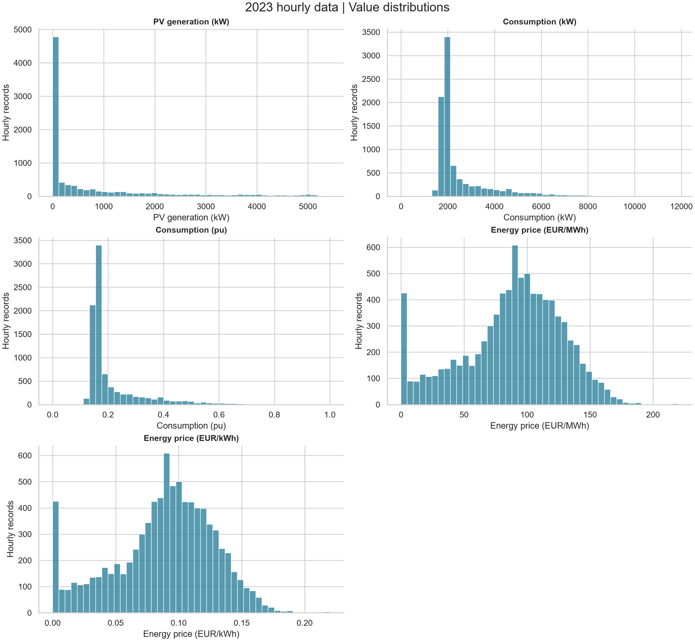
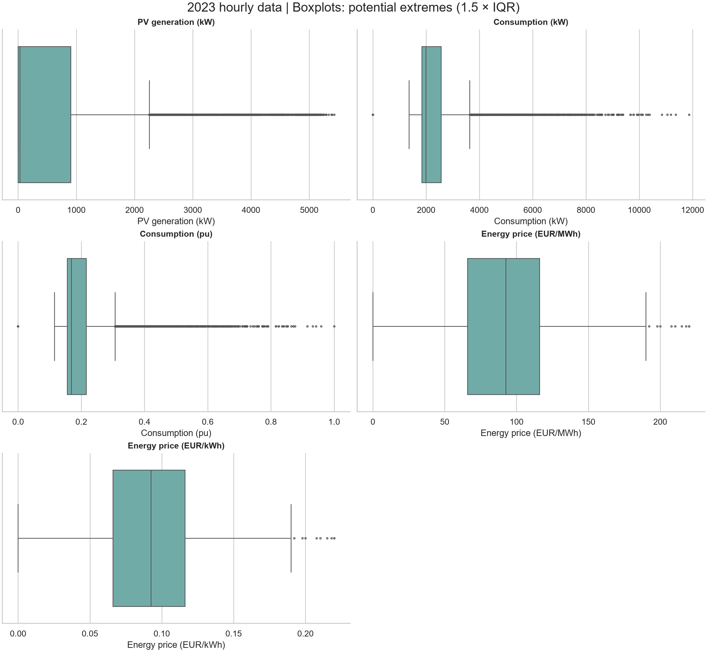
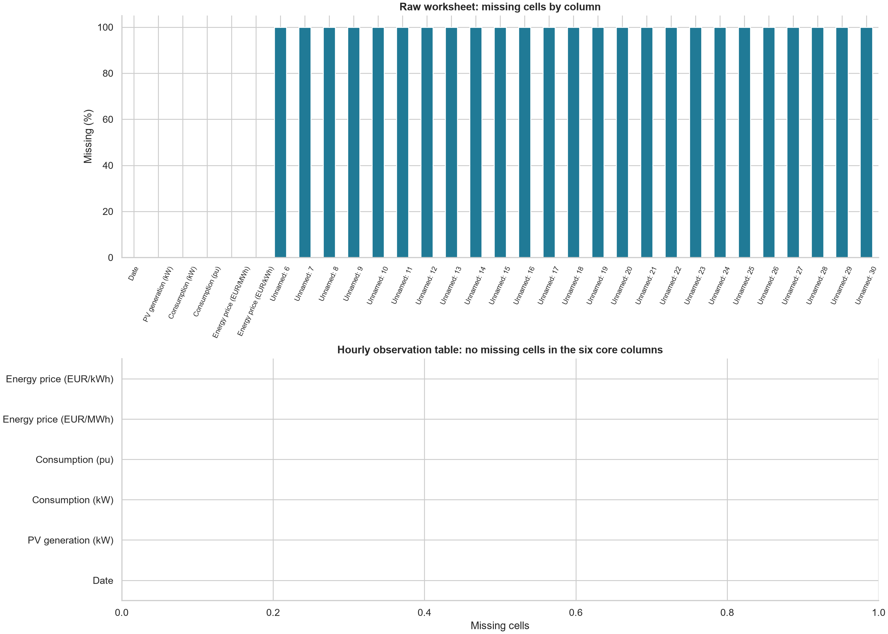

# Step 2: Data Quality Assessment & Descriptive Statistics

    ## Scope and method / Kaam ka daira
    Actual values were read with Pandas from `data/Dataset.xlsx`, sheet `2023 data`. No values were filled, deleted from the source, or corrected. No Step 3 or ML training was performed. SHA-256 before and after: `889e282c228a1e7c80969df375497a40f24ef08eb9690318ffb97928526bd9c8` (identical).

    Roman Urdu: Asal Excel values par analysis hua. Original file mein koi tabdeeli nahin ki. Sirf Step 2 ki jaanch aur statistics banaye gaye.

    ## 1. Structure and dates / Data ki banawat
    Purpose: establish what one record means before calculating statistics. The raw import has 8,765 rows and 31 columns, excluding the Excel header. There are 8,760 hourly observations, six labelled core columns, 20 fully empty columns and five unnamed columns with 20 auxiliary values of unknown meaning. Four blank rows and one URL footer are outside the observation table. These are documented separately; unnamed values were not silently treated as measurements. `column_inventory.csv` preserves all imported column types and missing counts. Date is initially object because it mixes datetimes and the URL; all five core measurements import as float64.

    Hourly coverage is 2023-01-01 00:00:00 through 2023-12-31 23:00:00, with no timezone stored in the timestamps. We do not assume a local timezone or daylight-saving rule.

    Roman Urdu: Har asal row aik ghantay ka record hai. Sheet ke aakhir mein 4 khaali rows aur aik source link hai. Unnamed columns ki 20 values ka matlab clear nahin, is liye unhein alag record kiya. Is se statistics mein ghair mutaliqa cells shamil nahin hotay aur research ka data scope saaf rehta hai.

    ## 2. Missing values, duplicates and invalid data / Data ki jaanch
    Purpose: detect incomplete or repeated observations and impossible representations. The core hourly table has 0 missing cells, 0 excess duplicate full rows, and 0 excess duplicate timestamps. There are 0 non-numeric measurements and 0 non-finite measurements. All 8760 observations are in 2023 and aligned to full hours. The URL footer is metadata, not an invalid hourly observation. Raw-sheet missing counts include intentionally blank areas; they must not be confused with missing hourly measurements.

    Roman Urdu: Asal hourly table mein missing value ya duplicate record nahin mila. Number wali columns mein text ya infinity bhi nahin mili. Khaali side columns ko missing hourly data kehna ghalat hota. Yeh jaanch research mein completeness aur double counting ko samajhne mein madad karti hai.

    ## 3. Zeros, negatives and outliers / Zero aur intehai values
    Purpose: identify values needing context. Outliers use Q1 − 1.5 × IQR and Q3 + 1.5 × IQR, where IQR = Q3 − Q1. These are review flags, not proof of errors. No automatic removal was done. Negative generation/load would be suspicious under the stated generation/consumption meanings; negative market prices could be valid. No site capacity or sensor specification is provided, so positive values cannot all be certified physically valid.

    | column | zero | negative | IQR_outlier | IQR_lower | IQR_upper |
| --- | --- | --- | --- | --- | --- |
| PV generation (kW) | 4046 | 0 | 1011 | -1353 | 2255 |
| Consumption (kW) | 4 | 0 | 1238 | 762.5 | 3638.5 |
| Consumption (pu) | 4 | 0 | 1238 | 0.0642592 | 0.306632 |
| Energy price (EUR/MWh) | 70 | 0 | 9 | -9.4275 | 191.392 |
| Energy price (EUR/kWh) | 70 | 0 | 9 | -0.0094275 | 0.191392 |

    PV zeros can reflect no sunlight, but this assessment cannot prove every zero is correct. Consumption zeros may represent shutdown, outage or missing readings encoded as zero; source confirmation is needed. Zero electricity prices may be real or placeholders and also need source confirmation. High PV/load values may be legitimate peaks. Both price columns and both consumption columns describe the same underlying quantities, so their flags are not independent events.

    Roman Urdu: Zero ko missing nahin samjha. Solar ka zero dhoop na honay ki wajah se ho sakta hai. Load ka zero shutdown ya meter ka masla bhi ho sakta hai. Price ka zero asal rate ya placeholder ho sakta hai. IQR sirf unusual values dikhata hai; yeh lazmi ghalti nahin. Is liye koi value remove nahin ki. Research mein peaks aur mumkin measurement issues alag samajhne mein madad milti hai.

    ## 4. Timestamp gaps / Waqt ka tasalsul
    Purpose: compare unique timestamps to all 8,760 expected hours of the non-leap year 2023. Missing hours: 0; outside-year timestamps: 0; non-increasing intervals in original order: 0. All consecutive sorted observations are one hour apart. This verifies the stored naive hourly grid, not timezone correctness.

    Roman Urdu: 2023 ke tamam 8,760 ghantay maujood hain aur har agla record aik ghantay baad hai. Koi gap nahin mila. Is se time-based research mein sequence par bharosa barhta hai, lekin timezone ki tasdeeq nahin hoti.

    ## 5. Descriptive statistics / Buniyadi statistics
    Purpose: summarize typical size, spread and extremes. Mean is the average; median is the middle value; sample Std (ddof=1) measures spread; Q1 and Q3 are the 25th and 75th percentiles (Pandas linear interpolation). Only the five core numerical measurements enter this table; auxiliary numbers have no defined variable meaning. All 8,760 observations, including zeros and outlier flags, are retained.

    | index | Count | Min | Max | Mean | Median | Std | Q1 | Q3 |
| --- | --- | --- | --- | --- | --- | --- | --- | --- |
| PV generation (kW) | 8760 | 0 | 5429 | 714.99 | 31 | 1211.85 | 0 | 902 |
| Consumption (kW) | 8760 | 0 | 11866 | 2514.26 | 1992 | 1293.02 | 1841 | 2560 |
| Consumption (pu) | 8760 | 0 | 1 | 0.211888 | 0.167875 | 0.108969 | 0.155149 | 0.215742 |
| Energy price (EUR/MWh) | 8760 | 0 | 220 | 88.2705 | 92.495 | 39.9421 | 65.88 | 116.085 |
| Energy price (EUR/kWh) | 8760 | 0 | 0.22 | 0.0882705 | 0.092495 | 0.0399421 | 0.06588 | 0.116085 |

    Roman Urdu: Mean average hai, median beech ki value hai, aur Std values ka phailao batata hai. Q1 tak 25% aur Q3 tak 75% values hoti hain. PV ka mean 714.99 kW aur median 31.00 kW hai; yeh unequal distribution dikhata hai. Load ka mean 2514.26 kW hai. Research mein typical demand, variability aur peak levels samajhne ke liye yeh numbers kaam aate hain.

    ## 6. Normalization and unit conversion / Scale aur units ki tasdeeq
    The actual column name is `Consumption (pu)` (the requested p.u. variable). Every row matches `Consumption (kW) / 11866`, where 11,866 kW is the observed annual maximum. Maximum absolute difference: 1.11e-16; mismatches at absolute tolerance 1e-10: 0. Values are between 0 and 1. This verifies numerical consistency with annual-maximum scaling. Because the minimum load is zero, min–max scaling gives the same values; the intended normalization method/base cannot be uniquely established without documentation. Stored cells are numeric values, not formulas.

    Every price row matches `EUR/kWh = EUR/MWh / 1000`: 1 MWh equals 1,000 kWh. Maximum absolute difference: 0; mismatches: 0. This verifies the unit arithmetic, not the correctness of the underlying market prices or source timezone. For example, the maximum 220 EUR/MWh becomes 0.220 EUR/kWh.

    Roman Urdu: Har load value ko 11,866 se divide karne par workbook ka pu milta hai. Zero minimum ki wajah se min–max ka result bhi yahi hai, is liye asal method documentation ke baghair final nahin keh sakte. Price ko 1,000 se divide karna har row mein sahi mila. Is se units ki wajah se 1,000 guna ghalti se bacha ja sakta hai. Yeh sirf verification hai; nayi scaling ya training nahin ki gayi.

    ## 7. Graphs / Tasaveer
    - `graphs/distributions.png`: histograms show frequency and skew, using original units and zeros. PV has many low/zero values and a right tail; consumption also has a high-value tail.
    - `graphs/boxplots.png`: separate axes preserve each unit; dots show the IQR flags, which need interpretation.
    - `graphs/missing_values.png`: distinguishes raw-sheet blank areas from the complete six-column hourly table.

    Roman Urdu: Histogram batata hai konsi values zyada aati hain. Boxplot unusual values ko nazar mein lata hai. Missing graph side ke khaali cells aur asal data ka farq dikhata hai. Yeh graphs research findings ko asani se explain karne mein madad karte hain.

    
    
    

    ## Conclusion and saved evidence / Natija aur files
    The hourly grid is complete and the two derived columns are numerically consistent. The main unresolved questions are the meaning of auxiliary cells and the authenticity of zero/large readings. No cleaning or later research step was performed.

    Roman Urdu: Ghanton ka record mukammal hai aur conversion checks sahi hain. Extra cells aur zero/bohat bari values ki source se tasdeeq baqi hai. Original data mehfooz hai; Step 3 shuru nahin hua.

    CSV evidence: column inventory, non-observation rows, auxiliary cells, descriptive statistics, quality summary, flagged values (including zeros), duplicate records, missing timestamps, timestamp irregularities, and row-by-row normalization/conversion checks. Excel row numbers include the header, so the first observation is row 2. JSON records headline checks, source hashes and runtime versions. Reproduce from repository root with `python outputs/step_2/step_2_analysis.py`; dependencies are in `requirements.txt`.
